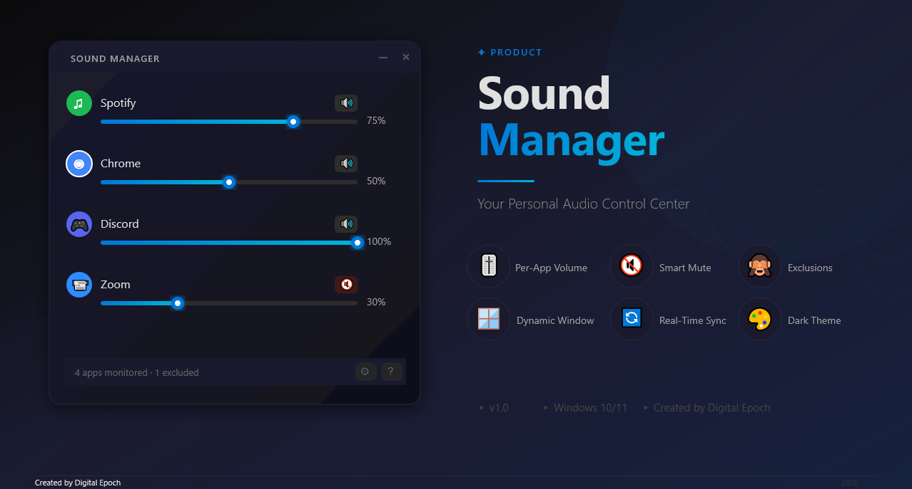

# 🎵 Sound Manager

A lightweight Windows app for **per-application volume control**, built with Python, PyQt6 and pycaw.



## Features

- Independent volume control for every app that is playing audio
- Exclusion list to hide apps you never want to see
- Compact, always-accessible window with remembered position and size
- Packages into a single standalone `SoundManager.exe`

See [docs/USAGE_GUIDE.md](docs/USAGE_GUIDE.md) and [docs/EXCLUSIONS_FEATURE.md](docs/EXCLUSIONS_FEATURE.md) for details.

## Run from source

Requires Windows and Python 3.9+.

```bash
pip install -r requirements.txt
python sound_manager_gui.py
```

`config.json` and `exclusions.json` are created next to the app on first use.

## Build the executable

```bash
python build_exe.py          # full build (installs PyInstaller if missing)
python build_exe.py --quick  # rebuild from SoundManager.spec
```

Or run `build_exe.bat` / `REBUILD.bat`. Output: `dist\SoundManager.exe`.
More in [docs/BUILD_INSTRUCTIONS.md](docs/BUILD_INSTRUCTIONS.md).

> The built `.exe` (~50 MB) is not tracked in git. Publish it as a GitHub Release asset instead.

## Repository layout

| Path | Description |
|------|-------------|
| `sound_manager_gui.py` | Application source |
| `sound_manager_icon.ico` | App icon |
| `SoundManager.spec`, `build_exe.py`, `build_exe.bat`, `REBUILD.bat` | Build tooling |
| `docs/` | Usage, build, distribution and implementation docs |
| `docs/release/` | End-user README and quick reference shipped with the exe |
| `docs/product-presentation/` | Product presentation / marketing docs |
| `docs/images/` | Screenshots |

---

Created by Digital Epoch
